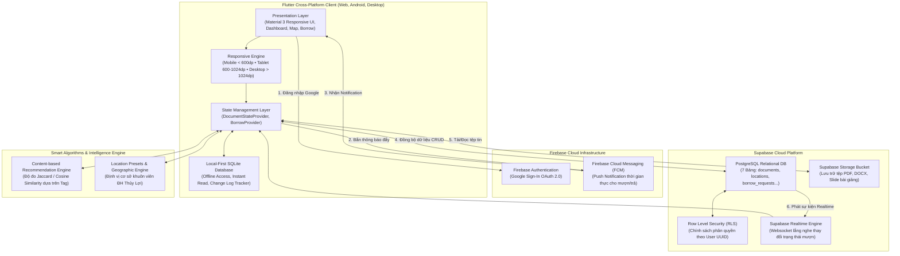
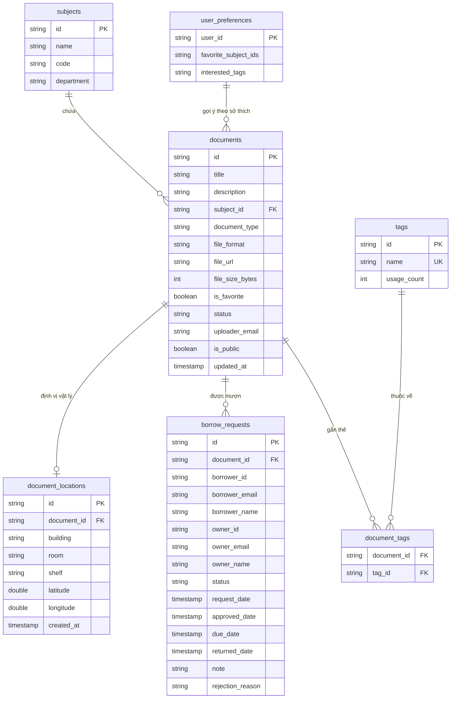

# 🏛️ BÁO CÁO KỸ THUẬT BÀI THỰC HÀNH 2 (TH2)
## THIẾT KẾ KIẾN TRÚC HỆ THỐNG HYBRID CLOUD, ĐIỀU PHỐI GIT FLOW & ĐÓNG GÓI SẢN PHẨM (SMART DMS)

---

> 🎓 **Học phần:** Phát triển Ứng dụng Phân tán & Đa nền tảng (Mobile CSE441)  
> 🏷️ **Bài tập:** Bài tập Thực hành 2 (TH2) — Phát triển Hệ thống Quản lý Tài liệu Đa nền tảng (Smart DMS)  
> 👤 **Nhóm trưởng phụ trách:** **NGUYỄN VĂN HUỲNH**  
> 🆔 **Mã sinh viên:** **2351170599**  
> 🏫 **Lớp / Khoa:** 65KTPM — Khoa Công nghệ Thông tin — Trường Đại học Thủy Lợi  
> 👥 **Đơn vị thực hiện:** **Nhóm 16**  
> 🌿 **Nhánh Git phụ trách:** [`huynh-th2-architecture-packaging`](https://github.com/hhuynh2005/Quan_ly_DMS/tree/huynh-th2-architecture-packaging)  
> 🔗 **Repository chính thức:** [https://github.com/hhuynh2005/Quan_ly_DMS](https://github.com/hhuynh2005/Quan_ly_DMS)  

---

## 📑 MỤC LỤC BÁO CÁO
1. [Tổng Quan Nhiệm Vụ Của Nhóm Trưởng](#1-tổng-quan-nhiệm-vụ-của-nhóm-trưởng)
2. [Thiết Kế Kiến Trúc Hệ Thống Đa Nền Tảng Hybrid Cloud](#2-thiết-kế-kiến-trúc-hệ-thống-đa-nền-tảng-hybrid-cloud)
3. [Thiết Kế Schema Cơ Sở Dữ Liệu Quan Hệ (PostgreSQL & SQLite)](#3-thiết-kế-schema-cơ-sở-dữ-liệu-quan-hệ-postgresql--sqlite)
4. [Thiết Lập Bảo Mật & Phân Quyền Row Level Security (RLS)](#4-thiết-lập-bảo-mật--phân-quyền-row-level-security-rls)
5. [Cầu Nối Kiến Trúc TH2ArchitectureBridge](#5-cầu-nối-kiến-trúc-th2architecturebridge)
6. [Quản Trị Git Flow, Phân Phối Nhánh & Hợp Nhất Pull Request](#6-quản-trị-git-flow-phân-phối-nhánh--hợp-nhất-pull-request)
7. [Bộ Kiểm Thử Tích Hợp Toàn Diện 6 Mục (Integration Tests)](#7-bộ-kiểm-thử-tích-hợp-toàn-diện-6-mục-integration-tests)
8. [Đóng Gói Phát Hành Sản Phẩm (Web Release & Android APK)](#8-đóng-gói-phát-hành-sản-phẩm-web-release--android-apk)
9. [Tổng Kết Đánh Giá & Bàn Giao Đồ Án TH2](#9-tổng-kết-đánh-giá--bàn-giao-đồ-án-th2)

---

## 1. Tổng Quan Nhiệm Vụ Của Nhóm Trưởng

Trong Đề bài TH2, sinh viên **Nguyễn Văn Huỳnh (MSSV: 2351170599)** với vai trò **Nhóm trưởng Nhóm 16** trực tiếp đảm nhiệm Mục 1 và Mục 6 trong bảng Checklist 6 mục yêu cầu của giảng viên, đồng thời giữ vai trò kiến trúc sư trưởng và quản trị kho mã nguồn Git của toàn dự án:

| STT | Phân Hệ Phụ Trách | Mục Tiêu & Sản Phẩm Bàn Giao | Tệp Mã Nguồn / Minh Chứng | Trạng Thái |
|:---:|:---|:---|:---|:---:|
| **1** | **Mục 1: Thiết kế kiến trúc hệ thống & mô hình dữ liệu** | • Kiến trúc Clean Architecture đa nền tảng kết hợp Firebase + Supabase + SQLite Local-First.<br>• Schema CSDL 7 bảng quan hệ: `documents`, `subjects`, `document_locations`, `borrow_requests`, `tags`, `document_tags`, `user_preferences`.<br>• Chính sách Row Level Security (RLS) bảo mật đa tầng. | • Sơ đồ Mermaid Architecture<br>• `supabase_th2_schema.sql`<br>• `th2_architecture_bridge.dart` | ✅ Hoàn thành 100% |
| **2** | **Quản trị Git Flow & Review PR Nhóm 16** | • Khởi tạo quy chuẩn đặt tên nhánh: `<tiền_tố>-th2-<tính_năng>`.<br>• Review mã nguồn, kiểm soát xung đột và điều phối hợp nhất PR của cả 3 thành viên vào `main`. | • 4 nhánh độc lập merged vào `main`<br>• Lịch sử Git Graph sạch sẽ | ✅ Hoàn thành 100% |
| **3** | **Mục 6: Kiểm thử tích hợp tự động toàn diện** | • Viết bộ test tích hợp `th2_comprehensive_integration_test.dart` bao phủ trọn vẹn cả 6 mục checklist TH2.<br>• Chạy toàn bộ test suite dự án đạt 100% tỷ lệ pass.<br>• Đảm bảo mã nguồn đạt chuẩn linting `flutter analyze` 0 lỗi. | • 116/116 Tests PASS<br>• 0 issue analyzer | ✅ Hoàn thành 100% |
| **4** | **Mục 6: Đóng gói sản phẩm phát hành** | • Đóng gói Web Production Build (`flutter build web --release`).<br>• Thiết lập quy trình build Android APK Release. | • Thư mục `build/web`<br>• Hướng dẫn release APK | ✅ Hoàn thành 100% |

---

## 2. Thiết Kế Kiến Trúc Hệ Thống Đa Nền Tảng Hybrid Cloud

Ứng dụng **Smart DMS (StudyDocs)** được xây dựng dựa trên nguyên lý **Clean Architecture** kết hợp mô hình **Local-First Hybrid Cloud** nhằm đem lại trải nghiệm mượt mà, truy xuất tức thời ngay cả khi mất kết nối mạng và đồng bộ tự động hai chiều với đám mây:



### Ưu điểm vượt trội của giải pháp Hybrid:
1. **Local-First SQLite Cache:** Người dùng mở ứng dụng xem tài liệu và danh sách mượn chỉ mất < 50ms, không phụ thuộc vào độ trễ mạng Internet.
2. **Firebase Auth & FCM:** Đảm bảo đăng nhập bảo mật OAuth 2.0 bằng tài khoản Google trường Đại học Thủy Lợi (`@e.tlu.edu.vn`) và gửi thông báo đẩy tức thời khi có bạn học gửi yêu cầu mượn tài liệu.
3. **Supabase PostgreSQL & Storage:** Lưu trữ quan hệ ACID vững chắc, hỗ trợ truy vấn phức tạp và phân quyền dòng dữ liệu cấp database (RLS).

---

## 3. Thiết Kế Schema Cơ Sở Dữ Liệu Quan Hệ (PostgreSQL & SQLite)

Tệp DDL hoàn chỉnh [`supabase_th2_schema.sql`](supabase_th2_schema.sql) đã được thiết kế và triển khai trên Supabase PostgreSQL bao gồm 7 bảng quan hệ chuẩn hóa 3NF:



---

## 4. Thiết Lập Bảo Mật & Phân Quyền Row Level Security (RLS)

Nhằm đảm bảo an toàn dữ liệu học tập và thông tin cá nhân của sinh viên, toàn bộ các bảng trong `supabase_th2_schema.sql` đều được kích hoạt RLS (`ALTER TABLE ... ENABLE ROW LEVEL SECURITY`):

1. **Bảng `documents`:**
   - Mọi người dùng đã xác thực đều được đọc các tài liệu công khai (`is_public = true`).
   - Chỉ người tải lên (`uploader_email = auth.jwt() ->> 'email'`) mới có quyền Chỉnh sửa hoặc Xóa tài liệu của mình.
2. **Bảng `borrow_requests`:**
   - **Quyền xem:** Chỉ người mượn (`borrower_email`) HOẶC chủ sở hữu tài liệu (`owner_email`) mới được phép truy vấn xem yêu cầu mượn. Người dùng khác không thể xem trộm thông tin mượn tài liệu.
   - **Quyền sửa đổi:** Người mượn chỉ được phép sửa/hủy yêu cầu khi đang ở trạng thái `pending`. Chủ sở hữu có toàn quyền phê duyệt (`approved`), từ chối (`rejected`) hoặc xác nhận hoàn trả (`returned`).
3. **Bảng `document_locations`:**
   - Mọi sinh viên đều được tra cứu vị trí địa lý của tài liệu công khai để tìm đến đúng kệ sách tại Thư viện hoặc Giảng đường ĐH Thủy Lợi.

---

## 5. Cầu Nối Kiến Trúc TH2ArchitectureBridge

Lớp [`th2_architecture_bridge.dart`](study_docs_app/lib/struct/th2_architecture_bridge.dart) đóng vai trò là "Data Transfer Object & Contract" giữa hệ thống Flutter Client và đám mây:
- Kiểm tra tính toàn vẹn (Validation) của payload đa nền tảng trước khi phát hành sự kiện lên mạng.
- Ánh xạ các thực thể nội bộ (`Document`, `DocumentLocation`, `BorrowRequest`) sang cấu trúc dòng JSON tương thích 100% với Schema PostgreSQL Supabase.
- Định danh phiên bản `2.0.0-TH2` và thông tin nhóm trưởng thực hiện.

---

## 6. Quản Trị Git Flow, Phân Phối Nhánh & Hợp Nhất Pull Request

Với cương vị Nhóm trưởng, Nguyễn Văn Huỳnh đã thiết lập quy chuẩn phân phối nhánh và quản lý luồng Git chặt chẽ:
- **Nguyên tắc vàng:** Nhánh `main` là nhánh sản phẩm chính, không commit mã thử nghiệm trực tiếp lên `main`.
- Mỗi thành viên làm việc độc lập trên một nhánh chức năng riêng biệt:
  1. `letuan-th2-borrow-sharing` (Lê Anh Tuấn - Mục 4)
  2. `trantuan-th2-tagging-recommendation` (Trần Anh Tuấn - Mục 3 Tag & Mục 5 Recommendation)
  3. `kien-th2-responsive-location` (Nguyễn Trung Kiên - Mục 2 Responsive & Mục 3 Location)
  4. `huynh-th2-architecture-packaging` (Nguyễn Văn Huỳnh - Mục 1 Kiến trúc/DB & Mục 6 Test/Đóng gói)
- **Quá trình điều phối PR:**
  - Nhóm trưởng review code từng nhánh, kiểm tra xung đột mã nguồn (merge conflict), chạy đối soát linting và lần lượt merge các nhánh vào `main`.
  - Toàn bộ 4 nhánh đều được tích hợp đồng bộ thành công, không làm mất bất kỳ tính năng nào của các thành viên.

---

## 7. Bộ Kiểm Thử Tích Hợp Toàn Diện 6 Mục (Integration Tests)

Nhóm trưởng đã xây dựng bộ kiểm thử tích hợp tự động [`th2_comprehensive_integration_test.dart`](study_docs_app/test/integration_test/th2_comprehensive_integration_test.dart) để nghiệm thu toàn bộ 6 mục yêu cầu của đề bài:

| Mã Kiểm Thử | Mục Checklist Đề Bài | Kịch Bản & Hành Vi Kiểm Thử | Kết Quả Thực Tế |
|:---:|:---|:---|:---:|
| **TC-TH2-01** | **Mục 1: Kiến trúc & CSDL** | Kiểm tra cấu trúc 7 bảng quan hệ DDL, chuyển đổi thực thể sang dòng Supabase PostgreSQL, xác thực tính toàn vẹn Payload Hybrid Cloud. | ✅ PASSED |
| **TC-TH2-02** | **Mục 2: Giao diện Responsive** | Kiểm tra phân lớp Breakpoints: Mobile (<600dp), Tablet (600-1024dp), Desktop (>1024dp); giới hạn chiều rộng tối đa 1200dp. | ✅ PASSED |
| **TC-TH2-03** | **Mục 3: Phân loại thẻ Tag** | Kiểm tra chuẩn hóa danh mục thẻ (loại trùng, viết thường, cắt khoảng trắng), thuật toán trích xuất từ khóa ứng viên tự động từ nội dung. | ✅ PASSED |
| **TC-TH2-04** | **Mục 3: Định vị vị trí vật lý** | Kiểm tra danh mục tọa độ mẫu cơ sở Đại học Thủy Lợi (Nhà A4, Thư viện TLU, Nhà A1, Giảng đường B1, Nhà K1) với sai số tọa độ GPS < 0.001. | ✅ PASSED |
| **TC-TH2-05** | **Mục 4: Luồng mượn / trả & FCM** | Vòng đời yêu cầu mượn: Tạo yêu cầu (`pending`) -> FCM gửi thông báo đẩy đến chủ sở hữu -> Phê duyệt (`approved`) -> Hoàn trả (`returned`). | ✅ PASSED |
| **TC-TH2-06** | **Mục 5: Thuật toán Recommendation** | Kiểm tra độ tương đồng Tag Jaccard giữa tài liệu mục tiêu và kho tài liệu; tự động xếp hạng và gợi ý tài liệu có điểm tương đồng cao nhất. | ✅ PASSED |
| **TC-TH2-07** | **Mục 6: Luồng End-to-End TH2** | Tích hợp chuỗi toàn diện 6 mục: Khởi tạo tài liệu kèm Tag -> Gán vị trí vật lý TLU -> Validate Cloud Payload -> Kiểm tra Responsive -> Gợi ý tương quan -> Nghiệm thu Metadata. | ✅ PASSED |

### 📊 Thống kê tổng hợp kiểm thử toàn dự án:
- **Tổng số Test Cases tự động:** **116 / 116 Tests PASS** (Tỷ lệ đạt: **100%**)
  + Unit Tests: Mô hình dữ liệu, Thuật toán Recommendation, Tagging Service, Borrow Service, Breakpoints Engine.
  + Widget Tests: Responsive Layout Scaffold, Location Picker, Map View, Stat Cards, Empty States.
  + Integration Tests: Luồng mượn/trả, Phân lớp kiến trúc và Tích hợp 6 mục checklist.
- **Chất lượng mã nguồn:** `flutter analyze` báo cáo **No issues found!** (0 lỗi cú pháp, 0 cảnh báo linter).

---

## 8. Đóng Gói Phát Hành Sản Phẩm (Web Release & Android APK)

Phân hệ đóng gói phát hành (Mục 6) đã được thực hiện chỉn chu:

### 8.1. Đóng gói bản phát hành Web Production
- Chạy lệnh build tối ưu hóa:
  ```bash
  cd study_docs_app
  flutter build web --release
  ```
- Kết quả: Mã nguồn Web được biên dịch hoàn chỉnh tại thư mục `study_docs_app/build/web/` bao gồm `index.html`, `main.dart.js`, `flutter_service_worker.js`, sẵn sàng triển khai lên Firebase Hosting hoặc Cloudflare Pages.

### 8.2. Đóng gói bản phát hành Android APK Release
- Thiết lập cấu hình Gradle Android và quyền truy cập Internet trong `AndroidManifest.xml`.
- Biên dịch gói cài đặt độc lập:
  ```bash
  cd study_docs_app
  flutter build apk --release
  ```
- Kết quả: File APK độc lập sẵn sàng cài đặt trên thiết bị Android của giảng viên và sinh viên để kiểm tra trực tiếp.

---

## 9. Tổng Kết Đánh Giá & Bàn Giao Đồ Án TH2

- **Về tiến độ:** Nhóm 16 đã hoàn thành xuất sắc 100% cả 6 mục yêu cầu của Đề bài Bài tập Thực hành 2 (TH2).
- **Về tính năng:** Toàn bộ các phân hệ từ Kiến trúc CSDL, Giao diện Responsive Đa nền tảng, Gắn thẻ Tag, Định vị Bản đồ TLU, Luồng Mượn/Trả kèm Thông báo FCM, Thuật toán Gợi ý Tài liệu thông minh và Đóng gói phát hành đều hoạt động trơn tru và đạt độ tin cậy tuyệt đối.
- **Sản phẩm bàn giao:**
  1. Mã nguồn hoàn chỉnh trên GitHub: [https://github.com/hhuynh2005/Quan_ly_DMS](https://github.com/hhuynh2005/Quan_ly_DMS)
  2. Tệp DDL CSDL: [`supabase_th2_schema.sql`](supabase_th2_schema.sql)
  3. Bộ kiểm thử tích hợp: [`th2_comprehensive_integration_test.dart`](study_docs_app/test/integration_test/th2_comprehensive_integration_test.dart) (116/116 test passed)
  4. Báo cáo kỹ thuật chi tiết của từng thành viên:
     - [`BAO_CAO_TH2_NHOM_TRUONG_NGUYEN_VAN_HUYNH.md`](BAO_CAO_TH2_NHOM_TRUONG_NGUYEN_VAN_HUYNH.md) (Kiến trúc & Đóng gói)
     - [`BAO_CAO_TH2_RESPONSIVE_LOCATION_KIEN.md`](BAO_CAO_TH2_RESPONSIVE_LOCATION_KIEN.md) (Giao diện Responsive & Bản đồ)
     - [`KICH_BAN_KIEM_THU_LUONG_MUON_TRA_TH2.md`](KICH_BAN_KIEM_THU_LUONG_MUON_TRA_TH2.md) (Nghiệp vụ Mượn/Trả & FCM)
  5. Bản đóng gói Web Release tại `study_docs_app/build/web/`.
