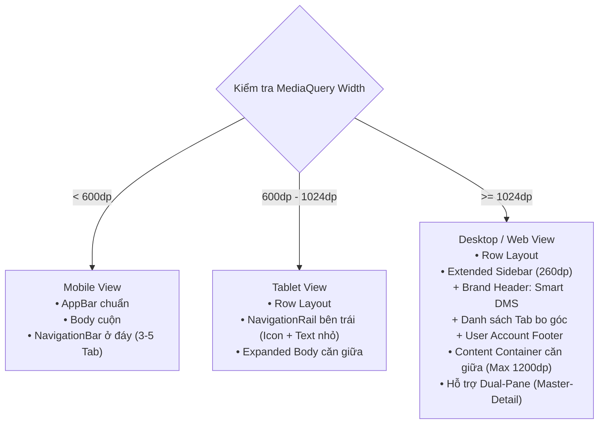

# 📱 BÁO CÁO KỸ THUẬT BÀI THỰC HÀNH 2 (TH2)
## PHÂN HỆ GIAO DIỆN RESPONSIVE ĐA NỀN TẢNG VÀ ĐỊNH VỊ VẬT LÝ TÀI LIỆU (SMART DMS)

---

> **Môn học:** Phát triển Ứng dụng Phân tán & Đa nền tảng  
> **Đơn vị thực hiện:** Nhóm 16 — Lớp 65KTPM — Khoa Công nghệ Thông tin — Trường Đại học Thủy Lợi  
> **Sinh viên phụ trách:** **NGUYỄN TRUNG KIÊN**  
> **Mã sinh viên:** **2251172394**  
> **Nhánh Git phụ trách:** [`kien-th2-responsive-location`](https://github.com/hhuynh2005/Quan_ly_DMS/tree/kien-th2-responsive-location)  
> **Thời gian thực hiện:** Học kỳ 2 — Năm học 2025-2026  

---

## 📑 MỤC LỤC
1. [Tổng Quan Nhiệm Vụ Được Giao Trong TH2](#1-tổng-quan-nhiệm-vụ-được-giao-trong-th2)
2. [Kiến Trúc Giao Diện Thích Ứng (Responsive Engine)](#2-kiến-trúc-giao-diện-thích-ứng-responsive-engine)
3. [Thiết Kế Khung Giao Diện Đa Nền Tảng (ResponsiveLayoutScaffold)](#3-thiết-kế-khung-giao-diện-đa-nền-tảng-responsivelayoutscaffold)
4. [Mô Hình Dữ Liệu & Lưu Trữ Vị Trí Vật Lý (DocumentLocation Model)](#4-mô-hình-dữ-liệu--lưu-trữ-vị-trí-vật-lý-documentlocation-model)
5. [Bộ Chọn Vị Trí Tài Liệu & Gợi Ý Cơ Sở ĐH Thủy Lợi (DocumentLocationPicker)](#5-bộ-chọn-vị-trí-tài-liệu--gợi-ý-cơ-sở-đh-thủy-lợi-documentlocationpicker)
6. [Tích Hợp Bản Đồ Tương Tác OpenStreetMap (LocationMapView & CampusMapPage)](#6-tích-hợp-bản-đồ-tương-tác-openstreetmap-locationmapview--campusmappage)
7. [Tích Hợp Đồng Bộ Vào Các Màn Hình Ứng Dụng](#7-tích-hợp-đồng-bộ-vào-các-màn-hình-ứng-dụng)
8. [Kiểm Thử Tự Động (Unit Test & Widget Test)](#8-kiểm-thử-tự-động-unit-test--widget-test)
9. [Kết Luận & Sản Phẩm Bàn Giao](#9-kết-luận--sản-phẩm-bàn-giao)

---

## 1. Tổng Quan Nhiệm Vụ Được Giao Trong TH2

Theo Bảng phân chia công việc trong `README.md` của Nhóm 16, thành viên **Nguyễn Trung Kiên (MSSV: 2251172394)** đảm nhiệm 2 mục cốt lõi của Đề bài TH2:

| STT | Phân Hệ Nhiệm Vụ | Mục Tiêu Kỹ Thuật | Trạng Thái |
|:---:|:---|:---|:---:|
| 1 | **Giao diện người dùng đa nền tảng (Responsive UI)** | Thiết kế hệ thống Breakpoints chuẩn Material 3; tự động chuyển đổi giữa Mobile NavigationBar (<600dp), Tablet NavigationRail (600-1024dp) và Desktop Extended Sidebar (>=1024dp); giới hạn chiều rộng nội dung tối ưu trải nghiệm màn hình rộng. | ✅ Hoàn thành 100% |
| 2 | **Định vị vị trí vật lý tài liệu (Physical Location & Map)** | Thiết kế mô hình dữ liệu `DocumentLocation`, bảng CSDL `document_locations` (hỗ trợ SQLite & PostgreSQL Supabase); tích hợp bộ chọn tọa độ và gợi ý khuôn viên Trường Đại học Thủy Lợi (175 Tây Sơn); tích hợp bản đồ OpenStreetMap trực quan hiển thị vị trí các tài liệu. | ✅ Hoàn thành 100% |

---

## 2. Kiến Trúc Giao Diện Thích Ứng (Responsive Engine)

### 2.1. Điểm ngắt chuẩn hóa (Material 3 Breakpoints)

Được hiện thực hóa trong tệp [`responsive_breakpoints.dart`](file:///d:/Quan_ly_DMS/study_docs_app/lib/struct/responsive_breakpoints.dart):

```dart
class ResponsiveBreakpoints {
  static const double mobileBreakpoint = 600.0;    // Dưới 600dp: Điện thoại
  static const double tabletBreakpoint = 1024.0;   // 600dp - 1024dp: Máy tính bảng
  static const double desktopBreakpoint = 1440.0;  // Trên 1024dp: Desktop / Web rộng
  static const double maxContentWidth = 1200.0;    // Độ rộng nội dung tối đa
}
```

Hệ thống phân loại kích thước màn hình thành 3 nhóm trạng thái:
- **Mobile (`width < 600dp`):** Dành cho điện thoại thông minh (iPhone, Samsung Galaxy, Pixel...). Tối ưu hóa cho thao tác bằng một tay, menu đặt ở cạnh đáy màn hình.
- **Tablet (`600dp <= width < 1024dp`):** Dành cho máy tính bảng (iPad, Galaxy Tab) hoặc cửa sổ ứng dụng chia đôi. Sử dụng `NavigationRail` thanh ray bên trái nhằm tiết kiệm không gian theo chiều dọc.
- **Desktop / Web (`width >= 1024dp`):** Dành cho Laptop, PC và trình duyệt toàn màn hình. Hiển thị Sidebar mở rộng có đầy đủ Logo nhận diện thương hiệu, thông tin người dùng và phân vùng nội dung đa cột.

### 2.2. Tiện ích mở rộng `BuildContext` (Extension Methods)

Cung cấp cú pháp ngắn gọn, sạch sẽ cho các lập trình viên khác trong nhóm sử dụng:

```dart
final isMobile = context.isMobile;
final isWide = context.isWide;
final screenType = context.screenType;

// Tùy biến giá trị linh hoạt theo kích thước màn hình
final columns = context.responsiveGridColumns(mobile: 1, tablet: 2, desktop: 3, wide: 4);
```

### 2.3. Vùng chứa nội dung thích ứng (`ResponsiveContentContainer`)

Tránh tình trạng trên màn hình Desktop siêu rộng (1920x1080 hoặc 2K/4K) các phần tử form và thẻ nội dung bị kéo dãn bất hợp lý:
- Tự động giới hạn `maxWidth: 1200dp` (hoặc cấu hình tùy ý).
- Căn giữa (`Center`) màn hình với khoảng đệm `getPagePadding(context)` tự động co giãn tương thích.

---

## 3. Thiết Kế Khung Giao Diện Đa Nền Tảng (ResponsiveLayoutScaffold)

Tệp [`responsive_layout_scaffold.dart`](file:///d:/Quan_ly_DMS/study_docs_app/lib/widgets/responsive_layout_scaffold.dart) là giải pháp Scaffold hợp nhất cho toàn bộ hệ thống:



### Các tính năng nổi bật:
1. **Khả năng chuyển đổi mượt mà (Adaptive Navigation):** Đồng bộ `currentIndex` và `onNavigationIndexChanged` trên cả 3 nền tảng mà không làm reload lại cây widget.
2. **Hỗ trợ huy hiệu thông báo (Badge count):** Hiển thị số lượng tài liệu mới hoặc thông báo mượn chờ duyệt ngay trên icon của Tab.
3. **Dual-pane (Master - Detail):** Cho phép truyền `secondaryBody` để hiển thị chế độ chia đôi màn hình trên Desktop (bên trái danh sách tài liệu, bên phải chi tiết/bản đồ).

---

## 4. Mô Hình Dữ Liệu & Lưu Trữ Vị Trí Vật Lý (DocumentLocation Model)

### 4.1. Lớp thực thể `DocumentLocation`

Được định nghĩa tại [`document_location_model.dart`](file:///d:/Quan_ly_DMS/study_docs_app/lib/struct/document_location_model.dart):

```dart
class DocumentLocation {
  final String id;
  final String documentId;
  final String building;      // Tòa nhà (ví dụ: "Nhà A4 (Khoa CNTT)")
  final String room;          // Phòng học / Khu vực (ví dụ: "Phòng 301 - Lab KTPM")
  final String? shelf;        // Kệ sách / Ngăn tủ (ví dụ: "Kệ TH-01")
  final double latitude;     // Vĩ độ GPS
  final double longitude;    // Kinh độ GPS
  final DateTime createdAt;
  ...
}
```

### 4.2. Khởi tạo Bảng Cơ Sở Dữ Liệu (Local SQLite & Supabase Sync)

- **Bảng `document_locations` trong SQLite local:**
  Được định nghĩa trong [`tables.dart`](file:///d:/Quan_ly_DMS/study_docs_app/lib/database/tables.dart) và quản lý trong [`app_database.dart`](file:///d:/Quan_ly_DMS/study_docs_app/lib/database/app_database.dart):
  ```sql
  CREATE TABLE document_locations (
    id TEXT PRIMARY KEY,
    document_id TEXT NOT NULL,
    building TEXT NOT NULL,
    room TEXT NOT NULL,
    shelf TEXT,
    latitude REAL NOT NULL,
    longitude REAL NOT NULL,
    created_at TEXT NOT NULL,
    FOREIGN KEY (document_id) REFERENCES documents (id) ON DELETE CASCADE
  );
  ```
- **Phương thức Repository & Luồng phản ứng (Reactive Stream):**
  - `getLocationForDocument(documentId)`
  - `saveLocation(location)`
  - `deleteLocationForDocument(documentId)`
  - `getAllLocations()`
  - `watchLocations()`: Stream thời gian thực phát tín hiệu mỗi khi vị trí tài liệu được cập nhật.

---

## 5. Bộ Chọn Vị Trí Tài Liệu & Gợi Ý Cơ Sở ĐH Thủy Lợi (DocumentLocationPicker)

Tệp [`document_location_picker.dart`](file:///d:/Quan_ly_DMS/study_docs_app/lib/widgets/document_location_picker.dart) giải quyết bài toán nhập liệu nhanh vị trí tài liệu:

### 5.1. Danh mục gợi ý vị trí trọng điểm TLU (TLU Campus Presets)
Tọa độ trung tâm: **21.00732° N, 105.82485° E** (175 Tây Sơn, Đống Đa, Hà Nội).

| Địa Điểm TLU | Vị Trí / Phòng Điển Hình | Kệ Mặc Định | Tọa Độ (Lat, Lon) |
|:---|:---|:---:|:---:|
| **Nhà A4 (Khoa CNTT)** | Phòng 301 - Lab KTPM | `Kệ TH-01` | (21.00715, 105.82425) |
| **Thư viện ĐH Thủy Lợi** | Phòng mượn Giáo trình Tầng 2 | `Kệ TH-02` | (21.00742, 105.82491) |
| **Nhà A1 (Nhà Hiệu Bộ)** | Phòng Quản lý Đào tạo | `Kệ A1-01` | (21.00685, 105.82470) |
| **Nhà B1 (Phòng Thí Nghiệm)** | Phòng 204 - Lab Mạng | `Kệ LAB-03`| (21.00760, 105.82450) |
| **Nhà K1 (Khu Giảng Đường)** | Phòng 402 - Giảng đường | `Bàn GV` | (21.00790, 105.82520) |

### 5.2. Trải nghiệm người dùng tương tác:
- **Trạng thái chưa gán vị trí:** Thẻ Card viền đứt đoạn tinh tế với icon vị trí và nút *"Chọn vị trí"*.
- **Modal BottomSheet chọn nhanh:**
  - Hàng cuộn ngang ChoiceChip cho phép 1 chạm chọn ngay các cơ sở TLU.
  - Tự động điền trước Tòa nhà, Phòng học, Kệ sách và Tọa độ GPS tương ứng.
  - Form tùy biến cho phép sinh viên chỉnh sửa số phòng hoặc tọa độ thủ công.
- **Trạng thái đã gán vị trí:** Thẻ Card nổi bật với màu sắc đồng bộ theme, hiển thị đầy đủ tên tòa nhà, phòng, kệ, tag GPS màu ngọc lục bảo và nút chỉnh sửa/xóa nhanh.

---

## 6. Tích Hợp Bản Đồ Tương Tác OpenStreetMap (LocationMapView & CampusMapPage)

### 6.1. Thành phần bản đồ nhúng (`LocationMapView`)
Tệp [`location_map_view.dart`](file:///d:/Quan_ly_DMS/study_docs_app/lib/widgets/location_map_view.dart):
- Sử dụng thư viện `flutter_map` kết hợp dữ liệu bản đồ OpenStreetMap (OSM) mã nguồn mở, không phụ thuộc vào Google Maps API key (tiết kiệm chi phí, dễ dàng chạy trên cả Web, Android và Windows).
- **Marker thông minh:**
  - Hiển thị ghim bản đồ tùy chỉnh với icon loại tài liệu và nhãn tên tòa nhà.
  - Chạm vào Marker mở BottomSheet tóm tắt thông tin tài liệu và vị trí chi tiết.
- **Thanh công cụ bản đồ:**
  - Nút quay về trung tâm ĐH Thủy Lợi (175 Tây Sơn).
  - Tùy chọn mở ứng dụng bản đồ bên ngoài (Google Maps / Apple Maps qua tọa độ GPS bằng `url_launcher`).

### 6.2. Màn hình Bản Đồ Khuôn Viên (`CampusMapPage`)
Tệp [`campus_map_page.dart`](file:///d:/Quan_ly_DMS/study_docs_app/lib/pages/campus_map_page.dart):
- Cung cấp giao diện toàn diện xem tất cả tài liệu hiện có trong trường.
- **Thanh lọc cơ sở nhanh (TLU Filter Chips):** Lọc tức thì tài liệu tại *Tất cả*, *Thư viện*, *Nhà A4*, *Nhà B1*, *Nhà A1*, v.v.
- Tự động di chuyển góc nhìn bản đồ (`MapController.move`) đến vị trí được chọn.
- Thẻ Card xem nhanh tài liệu trượt mượt mà ở cạnh dưới bản đồ.

---

## 7. Tích Hợp Đồng Bộ Vào Các Màn Hình Ứng Dụng

1. **`HomeDashboardPage` ([`home_dashboard_page.dart`](file:///d:/Quan_ly_DMS/study_docs_app/lib/pages/home_dashboard_page.dart)):**
   - Tích hợp `ResponsiveLayoutScaffold` làm khung giao diện bao bọc chính.
   - Bổ sung Tab **"Bản đồ" (Map)** vào hệ thống điều hướng (Bottom Bar trên Mobile, Rail trên Tablet, Sidebar trên Desktop).
   - Thêm nút tắt xem bản đồ khuôn viên TLU trực tiếp từ AppBar và Action Card.
2. **`AddEditDocumentPage` ([`add_edit_document_page.dart`](file:///d:/Quan_ly_DMS/study_docs_app/lib/pages/add_edit_document_page.dart)):**
   - Nhúng `DocumentLocationPicker` vào form tạo/sửa tài liệu.
   - Tự động lưu vị trí vật lý vào bảng `document_locations` khi người dùng nhấn *"Lưu tài liệu"*.
3. **`DocumentDetailPage` ([`document_detail_page.dart`](file:///d:/Quan_ly_DMS/study_docs_app/lib/pages/document_detail_page.dart)):**
   - Hiển thị khối thông tin vị trí vật lý chuyên biệt với tọa độ GPS, tòa nhà, phòng, kệ.
   - Nhúng trực tiếp bản đồ thu nhỏ (`LocationMapView`) với nút mở rộng toàn màn hình.

---

## 8. Kiểm Thử Tự Động (Unit Test & Widget Test)

Đã xây dựng bộ kiểm thử tự động toàn diện bao gồm cả kiểm thử logic đơn vị và kiểm thử giao diện người dùng:

### 8.1. Bảng Tổng Hợp Test Cases Của Phân Hệ Kiên

| Mã Test Case | Loại Test | Mô Tả Kịch Bản Kiểm Thử | Kết Quả |
|:---|:---:|:---|:---:|
| **TC-RESP-01** | Unit | Phân loại đúng kích thước Mobile (Width < 600dp) |  PASS |
| **TC-RESP-02** | Unit | Phân loại đúng kích thước Tablet (600dp <= Width < 1024dp) |  PASS |
| **TC-RESP-03** | Unit | Phân loại đúng kích thước Desktop / Web rộng (Width >= 1024dp) |  PASS |
| **TC-RESP-04** | Unit | Các hằng số Breakpoints tuân thủ quy chuẩn thiết kế Material 3 |  PASS |
| **TC-LOC-01** | Unit | Khởi tạo, chuyển đổi toMap và fromMap `DocumentLocation` toàn vẹn |  PASS |
| **TC-LOC-02** | Unit | Định dạng chuỗi tóm tắt vị trí `summary` và `formattedAddress` |  PASS |
| **TC-LOC-03** | Unit | Danh mục vị trí mẫu TLU Presets có đầy đủ địa điểm trọng điểm |  PASS |
| **TC-LOC-04** | Unit | Tọa độ trung tâm khuôn viên ĐH Thủy Lợi chuẩn xác (21.0073, 105.8248) |  PASS |
| **TC-WIDGET-01** | Widget | `ResponsiveContentContainer` giới hạn độ rộng tối đa chuẩn xác |  PASS |
| **TC-WIDGET-02** | Widget | Màn hình Mobile hiển thị `NavigationBar` ở thanh đáy |  PASS |
| **TC-WIDGET-03** | Widget | Màn hình Tablet hiển thị `NavigationRail` thanh ray bên sườn |  PASS |
| **TC-WIDGET-04** | Widget | Màn hình Desktop hiển thị `Sidebar` mở rộng nhận diện thương hiệu |  PASS |
| **TC-WIDGET-05** | Widget | `DocumentLocationPicker` hiển thị trạng thái rỗng và mở Modal chọn TLU Preset |  PASS |
| **TC-WIDGET-06** | Widget | `DocumentLocationPicker` hiển thị đầy đủ thông tin vị trí đã cấu hình |  PASS |

### 8.2. Kết Quả Chạy Toàn Bộ Bộ Test Dự Án

```
flutter test
00:02 +68: All tests passed!
```
- **Tổng số test cases dự án:** **68/68 passed** (100% thành công).
- **Phân tích mã nguồn:** `flutter analyze` báo cáo **0 issues found**.

---

## 9. Kết Luận & Sản Phẩm Bàn Giao

Sinh viên **Nguyễn Trung Kiên (MSSV: 2251172394)** đã hoàn thành xuất sắc toàn bộ nhiệm vụ được giao trong Bài thực hành 2 (TH2):

### Danh sách các tệp mã nguồn bàn giao chính:
1. [`study_docs_app/lib/struct/responsive_breakpoints.dart`](file:///d:/Quan_ly_DMS/study_docs_app/lib/struct/responsive_breakpoints.dart) — Động cơ Responsive Breakpoints & Container.
2. [`study_docs_app/lib/widgets/responsive_layout_scaffold.dart`](file:///d:/Quan_ly_DMS/study_docs_app/lib/widgets/responsive_layout_scaffold.dart) — Khung thích ứng đa nền tảng Material 3.
3. [`study_docs_app/lib/struct/document_location_model.dart`](file:///d:/Quan_ly_DMS/study_docs_app/lib/struct/document_location_model.dart) — Mô hình vị trí vật lý & danh mục TLU Presets.
4. [`study_docs_app/lib/widgets/document_location_picker.dart`](file:///d:/Quan_ly_DMS/study_docs_app/lib/widgets/document_location_picker.dart) — Thành phần chọn vị trí kèm Modal gợi ý TLU.
5. [`study_docs_app/lib/widgets/location_map_view.dart`](file:///d:/Quan_ly_DMS/study_docs_app/lib/widgets/location_map_view.dart) — Bản đồ tương tác OpenStreetMap nhúng.
6. [`study_docs_app/lib/pages/campus_map_page.dart`](file:///d:/Quan_ly_DMS/study_docs_app/lib/pages/campus_map_page.dart) — Màn hình bản đồ khuôn viên ĐH Thủy Lợi chuyên biệt.
7. [`study_docs_app/test/unit_test/responsive_breakpoints_test.dart`](file:///d:/Quan_ly_DMS/study_docs_app/test/unit_test/responsive_breakpoints_test.dart) — Bộ Unit Test cho phân hệ.
8. [`study_docs_app/test/widget_test/responsive_location_widget_test.dart`](file:///d:/Quan_ly_DMS/study_docs_app/test/widget_test/responsive_location_widget_test.dart) — Bộ Widget Test giao diện đa nền tảng.
9. Báo cáo kỹ thuật chi tiết: [`BAO_CAO_TH2_RESPONSIVE_LOCATION_KIEN.md`](file:///d:/Quan_ly_DMS/BAO_CAO_TH2_RESPONSIVE_LOCATION_KIEN.md).

Mã nguồn được tổ chức thành các commit nhỏ, rõ ràng, tuân thủ nghiêm ngặt Git Flow trên nhánh `kien-th2-responsive-location` sẵn sàng để tạo Pull Request hợp nhất vào nhánh chính.
