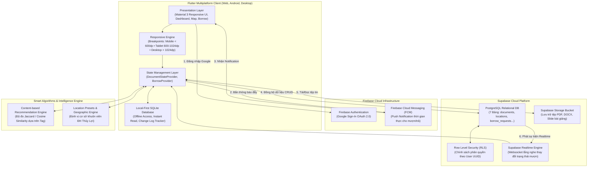
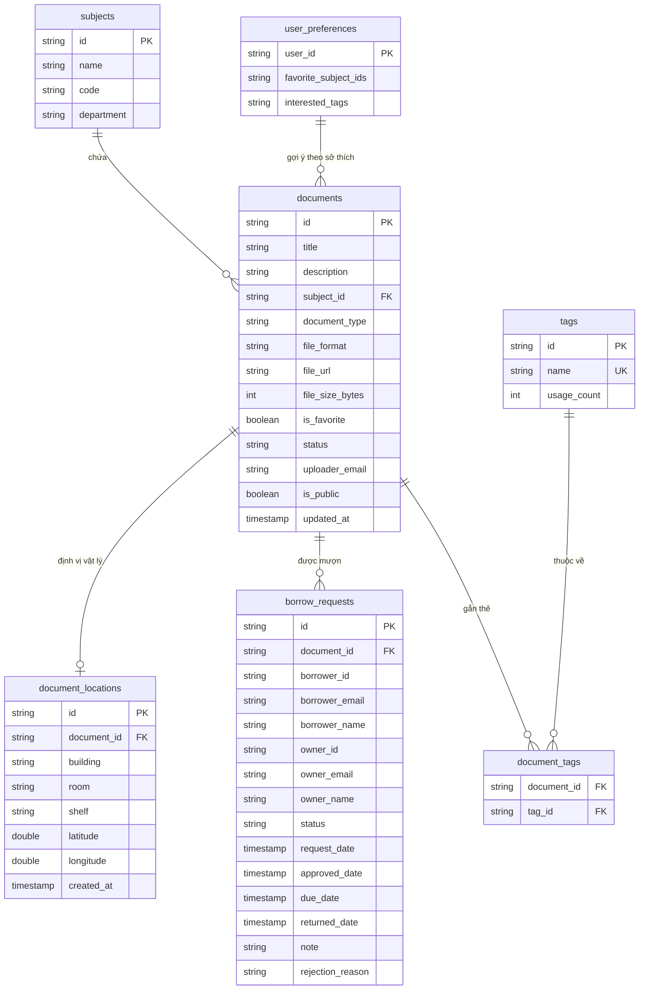
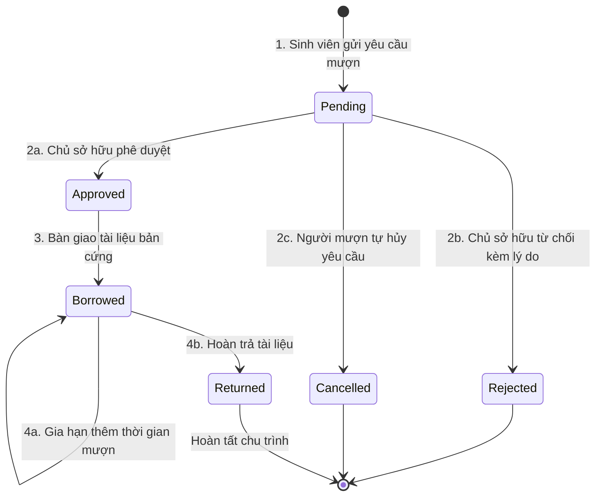

# 📘 BÁO CÁO TỔNG QUÁT BÀI TẬP THỰC HÀNH 2 (TH2)
# HỆ THỐNG QUẢN LÝ TÀI LIỆU HỌC TẬP ĐA NỀN TẢNG THÔNG MINH (SMART DMS)

---

> 🏛️ **BỘ NÔNG NGHIỆP VÀ PHÁT TRIỂN NÔNG THÔN — TRƯỜNG ĐẠI HỌC THỦY LỢI**  
> 🏢 **KHOA CÔNG NGHỆ THÔNG TIN — BỘ MÔN CÔNG NGHỆ PHẦN MỀM**  
> 📚 **Học phần:** Phát triển Ứng dụng Phân tán & Đa nền tảng (Mobile CSE441)  
> 🏷️ **Bài tập:** Bài tập Thực hành 2 (TH2) — Phát triển Hệ thống Quản lý Tài liệu Đa nền tảng (Smart DMS)  
> 👥 **Đơn vị thực hiện:** **Nhóm 16 — Lớp 65KTPM**  
> 🔗 **Repository GitHub:** [https://github.com/hhuynh2005/Quan_ly_DMS](https://github.com/hhuynh2005/Quan_ly_DMS)  
> 📅 **Thời gian hoàn thành:** Học kỳ 2 — Năm học 2025–2026  

---

### 👥 DANH SÁCH THÀNH VIÊN NHÓM 16 VÀ PHÂN CÔNG TRÁCH NHIỆM

| STT | Họ và Tên | Mã Sinh Viên | Vai Trò | Phân Hệ Nhiệm Vụ Phụ Trách (Checklist TH2) | Nhánh Git | Đóng Góp |
|:---:|:---|:---:|:---:|:---|:---:|:---:|
| **1** | **Nguyễn Văn Huỳnh** | **2351170599** | **Nhóm trưởng** | **Mục 1:** Kiến trúc hệ thống Hybrid Cloud, Schema CSDL PostgreSQL Supabase, phân quyền RLS.<br>**Mục 6:** Kiểm thử tích hợp tự động toàn diện, điều phối Git Flow & Đóng gói sản phẩm (Web & APK). | `huynh-th2-architecture-packaging` | 100% |
| **2** | **NGUYỄN TRUNG KIÊN** | **2251172394** | **Thành viên** | **Mục 2:** Xây dựng giao diện Responsive đa nền tảng (Adaptive Layout Mobile/Tablet/Desktop).<br>**Mục 3:** Tích hợp bản đồ số OpenStreetMap và định vị vị trí vật lý khuôn viên trường ĐH Thủy Lợi. | `kien-th2-responsive-location` | 100% |
| **3** | **Trần Anh Tuấn** | **2351170629** | **Thành viên** | **Mục 3:** Phân loại thẻ Tag thông minh (`SmartTaggingWidget`), tự động trích xuất từ khóa ứng viên, bộ lọc đa nhãn.<br>**Mục 5:** Nghiên cứu & hiện thực hóa thuật toán Recommendation gợi ý tài liệu theo độ đo Jaccard. | `trantuan-th2-tagging-recommendation` | 100% |
| **4** | **Lê Anh Tuấn** | **2151060296** | **Thành viên** | **Mục 4:** Xây dựng luồng nghiệp vụ Mượn / Trả tài liệu (`BorrowService`, `BorrowManagementPage`) & Thông báo đẩy thời gian thực qua Firebase Cloud Messaging (FCM). | `letuan-th2-borrow-sharing` | 100% |

---

## 📑 MỤC LỤC BÁO CÁO

- [Chương 1: Tổng Quan Đề Tài & Đối Soát 6 Mục Checklist](#chương-1-tổng-quan-đề-tài--đối-soát-6-mục-checklist)
- [Chương 2: Thiết Kế Kiến Trúc Hệ Thống & CSDL Hybrid Cloud (Mục 1)](#chương-2-thiết-kế-kiến-trúc-hệ-thống--csdl-hybrid-cloud-mục-1)
- [Chương 3: Giao Diện Người Dùng Đa Nền Tảng Responsive (Mục 2)](#chương-3-giao-diện-người-dùng-đa-nền-tảng-responsive-mục-2)
- [Chương 4: Phân Loại Bằng Tag & Định Vị Vị Trí Vật Lý Tài Liệu (Mục 3)](#chương-4-phân-loại-bằng-tag--định-vị-vị-trí-vật-lý-tài-liệu-mục-3)
- [Chương 5: Luồng Nghiệp Vụ Mượn / Trả & Thông Báo Đẩy FCM (Mục 4)](#chương-5-luồng-nghiệp-vụ-mượn--trả--thông-báo-đẩy-fcm-mục-4)
- [Chương 6: Thuật Toán Gợi Ý Tài Liệu Thông Minh - Recommendation Engine (Mục 5)](#chương-6-thuật-toán-gợi-ý-tài-liệu-thông-minh---recommendation-engine-mục-5)
- [Chương 7: Kiểm Thử Tự Động Toàn Diện & Đóng Gói Sản Phẩm (Mục 6)](#chương-7-kiểm-thử-tự-động-toàn-diện--đóng-gói-sản-phẩm-mục-6)
- [Chương 8: Hướng Dẫn Khởi Chạy Ứng Dụng & Kịch Bản Trình Diễn (Demo)](#chương-8-hướng-dẫn-khởi-chạy-ứng-dụng--kịch-bản-trình-diễn-demo)
- [Chương 9: Đánh Giá Kết Quả & Kết Luận](#chương-9-đánh-giá-kết-quả--kết-luận)

---

## CHƯƠNG 1: TỔNG QUAN ĐỀ TÀI & ĐỐI SOÁT 6 MỤC CHECKLIST

### 1.1. Bối cảnh & Mục tiêu đề tài
Trong môi trường học tập đại học hiện đại, nhu cầu lưu trữ, phân loại, tìm kiếm và chia sẻ giáo trình, bài giảng, đề cương thi cử giữa giảng viên và sinh viên là vô cùng cấp thiết. Hệ thống **Smart DMS (StudyDocs)** được Nhóm 16 phát triển bằng công nghệ **Flutter đa nền tảng**, kết hợp sức mạnh phân tán của **Firebase** (Xác thực Google OAuth, Thông báo đẩy FCM) và **Supabase** (Cơ sở dữ liệu quan hệ PostgreSQL thời gian thực, Storage, Row Level Security) cùng nguyên lý **Local-First (SQLite Cache)**.

Mục tiêu cốt lõi là mang lại một giải pháp quản lý tài liệu học tập thông minh, chạy mượt mà trên cả điện thoại (Mobile) và trình duyệt Web/Máy tính, tương tác hai chiều tức thời và hỗ trợ định vị chính xác vị trí tài liệu bản cứng trong khuôn viên Trường Đại học Thủy Lợi.

### 1.2. Bảng Đối Soát 6 Mục Checklist Yêu Cầu Của Giảng Viên

| STT | Mục Checklist Yêu Cầu Đề Bài | Mục Tiêu & Giải Pháp Triển Khai Kỹ Thuật | Thành Viên Phụ Trách | Trạng Thái Nghiệm Thu |
|:---:|:---|:---|:---:|:---:|
| **1** | **Thiết kế kiến trúc hệ thống và mô hình dữ liệu** | • Kiến trúc Clean Architecture kết hợp Firebase + Supabase + SQLite Local-First.<br>• Schema CSDL 7 bảng quan hệ chuẩn 3NF trên Supabase PostgreSQL.<br>• Thiết lập chính sách bảo mật Row Level Security (RLS) theo User UUID/Email. | **Nguyễn Văn Huỳnh** | ✅ **Hoàn thành 100%** |
| **2** | **Xây dựng giao diện người dùng đa nền tảng (Responsive)** | • Hệ thống Breakpoints Material 3: Mobile (<600dp), Tablet (600–1024dp), Desktop (≥1024dp).<br>• Tự động chuyển đổi giữa NavigationBar đáy, NavigationRail sườn và Sidebar mở rộng.<br>• Hộp chứa ResponsiveContentContainer và Grid động thích ứng co giãn linh hoạt. | **NGUYỄN TRUNG KIÊN** | ✅ **Hoàn thành 100%** |
| **3** | **Phân loại bằng Tag & Định vị vị trí vật lý tài liệu (Location)** | • **Smart Tagging:** Chuẩn hóa tag, tự động trích xuất ứng viên từ tiêu đề/mô tả bằng TF offline, autocomplete, lọc đa nhãn.<br>• **Location & Bản đồ:** Định vị vị trí vật lý (Tòa nhà, Phòng học, Kệ sách) tại 7 cơ sở trọng điểm ĐH Thủy Lợi (Nhà A4, Thư viện tầng 2/3...) và hiển thị trên bản đồ tương tác OpenStreetMap. | **Trần Anh Tuấn** (Tagging)<br>**NGUYỄN TRUNG KIÊN** (Location) | ✅ **Hoàn thành 100%** |
| **4** | **Luồng nghiệp vụ yêu cầu mượn & chia sẻ quyền truy cập** | • Xây dựng quy trình mượn/trả 6 trạng thái qua `BorrowService`: Gửi yêu cầu -> Chủ sở hữu phê duyệt/từ chối -> Đang mượn -> Đã hoàn trả.<br>• Tích hợp Firebase Cloud Messaging (FCM) gửi thông báo đẩy thời gian thực khi có yêu cầu mới.<br>• Giao diện 2 Tab quản lý yêu cầu kèm thanh chuyển đổi tài khoản Demo nhanh. | **Lê Anh Tuấn** | ✅ **Hoàn thành 100%** |
| **5** | **Thuật toán Recommendation gợi ý tài liệu thông minh** | • Thuật toán Content-based Filtering sử dụng **Hệ số tương đồng Jaccard (Jaccard Similarity Index)** giữa tập hợp thẻ Tag tài liệu.<br>• Bổ sung trọng số ưu tiên môn học (Subject Boost +0.3).<br>• Hiển thị khối gợi ý trực quan "Dành riêng cho bạn" trên Dashboard và Chi tiết tài liệu. | **Trần Anh Tuấn** | ✅ **Hoàn thành 100%** |
| **6** | **Kiểm thử toàn diện các tính năng & Đóng gói sản phẩm** | • Bộ kiểm thử tự động toàn diện: **116 / 116 Tests PASS (100%)** (Unit Tests, Widget Tests, Integration Tests).<br>• Chuẩn linter `flutter analyze` đạt **0 lỗi / 0 cảnh báo**.<br>• Đóng gói thành công bản phát hành Web Production (`build/web`) và Android APK Release. | **Nguyễn Văn Huỳnh** | ✅ **Hoàn thành 100%** |

---

## CHƯƠNG 2: THIẾT KẾ KIẾN TRÚC HỆ THỐNG & CSDL HYBRID CLOUD (MỤC 1)

### 2.1. Sơ đồ Kiến trúc Tổng thể (Hybrid Cloud Architecture)
Hệ thống được thiết kế theo mô hình **Clean Architecture 3 lớp** kết hợp giải pháp **Local-First Hybrid Cloud**:



### 2.2. Thiết kế Mô hình Cơ sở Dữ liệu Quan hệ (ERD Supabase PostgreSQL)
Tệp DDL [`supabase_th2_schema.sql`](supabase_th2_schema.sql) định nghĩa 7 bảng quan hệ chuẩn 3NF:



### 2.3. Phân quyền Dữ liệu & Row Level Security (RLS)
- **Bảo mật tài liệu (`documents`):** Cho phép mọi người dùng đã xác thực được đọc tài liệu công khai (`is_public = true`). Thao tác UPDATE / DELETE chỉ được chấp thuận nếu email người dùng trùng khớp với `uploader_email` (`auth.jwt() ->> 'email'`).
- **Bảo mật yêu cầu mượn (`borrow_requests`):** Chỉ người mượn (`borrower_email`) hoặc chủ sở hữu tài liệu (`owner_email`) mới có quyền SELECT / UPDATE bản ghi mượn tài liệu. Người lạ tuyệt đối không thể đọc lén thông tin mượn sách của sinh viên khác.

### 2.4. Cầu nối dữ liệu TH2ArchitectureBridge
Được triển khai trong tệp [`th2_architecture_bridge.dart`](study_docs_app/lib/struct/th2_architecture_bridge.dart):
- Cung cấp hàm `validateCrossPlatformPayload()`: Kiểm tra tính toàn vẹn của dữ liệu đa nền tảng (ID, mã môn học, vị trí tương ứng, yêu cầu mượn) trước khi truyền tải qua mạng.
- Cung cấp các hàm ánh xạ JSON (`documentToSupabaseRow`, `locationToSupabaseRow`, `borrowRequestToSupabaseRow`) tương thích 100% với kiểu dữ liệu của PostgreSQL.

---

## CHƯƠNG 3: GIAO DIỆN NGƯỜI DÙNG ĐA NỀN TẢNG RESPONSIVE (MỤC 2)

### 3.1. Hệ thống Breakpoints chuẩn Material 3 Adaptive
Được hiện thực trong [`responsive_breakpoints.dart`](study_docs_app/lib/struct/responsive_breakpoints.dart):
- **Điểm ngắt kích thước:**
  - `mobileBreakpoint = 600.0`
  - `tabletBreakpoint = 1024.0`
  - `desktopBreakpoint = 1440.0`
  - `maxContentWidth = 1200.0` (Giới hạn bề ngang tối đa để đảm bảo thị giác người đọc).
- **Phân loại thiết bị tự động (`DeviceScreenType`):**
  - `mobile`: Màn hình điện thoại dọc.
  - `tablet`: Máy tính bảng hoặc cửa sổ chia đôi.
  - `desktop`: Màn hình laptop, PC và trình duyệt toàn màn hình.

### 3.2. Khung giao diện ResponsiveLayoutScaffold
Tệp [`responsive_layout_scaffold.dart`](study_docs_app/lib/widgets/responsive_layout_scaffold.dart) tự động điều phối bố cục điều hướng:
1. **Trên Mobile:** Hiển thị `NavigationBar` dưới chân trang, hỗ trợ thao tác chạm bằng ngón tay cái thuận tiện.
2. **Trên Tablet:** Tự động co gọn thành thanh ray bên sườn `NavigationRail` gồm các biểu tượng tinh gọn, tiết kiệm tối đa diện tích hiển thị dọc.
3. **Trên Desktop / Web:** Mở rộng thành `Sidebar` đa năng bên trái có chứa Logo nhận diện thương hiệu Smart DMS TLU, thông tin sinh viên đang đăng nhập và danh mục điều hướng đa tầng.

### 3.3. Hộp chứa nội dung tự thích ứng (Adaptive Containers)
Tệp [`responsive_content_container.dart`](study_docs_app/lib/widgets/responsive_content_container.dart) đảm bảo các khối danh sách tài liệu tự động căn giữa và chia cột thông minh (1 cột trên Mobile, 2 cột trên Tablet, 3–4 cột trên màn hình Web lớn).

---

## CHƯƠNG 4: PHÂN LOẠI BẰNG TAG & ĐỊNH VỊ VỊ TRÍ VẬT LÝ TÀI LIỆU (MỤC 3)

### 4.1. Hệ thống Thẻ Tag thông minh (Smart Tagging)
Được triển khai trong [`tag_service.dart`](study_docs_app/lib/struct/tag_service.dart) và [`smart_tagging_widget.dart`](study_docs_app/lib/widgets/smart_tagging_widget.dart):
- **Chuẩn hóa nhãn (`normalizeTag`, `normalizeTags`):** Tự động cắt khoảng trắng đầu cuối, chuyển đổi chữ thường toàn bộ và gộp khoảng trắng thừa.
- **Trích xuất từ khóa ứng viên tự động (`extractCandidateTags`):**
  - Chạy bằng thuật toán đếm tần suất từ (Term Frequency - TF) hoàn toàn offline trên máy client.
  - Tích hợp bộ lọc từ dừng (Vietnamese Stop Words: *của, và, là, các, một, những, trong, với, cho, được, có, không...*) gồm hơn 40 hư từ tiếng Việt.
  - Khi sinh viên gõ tiêu đề/mô tả tài liệu, các từ khóa chuyên ngành xuất hiện nhiều nhất sẽ được đề xuất tức thì dưới dạng Chip để người dùng bấm chọn một chạm.
- **Bộ lọc đa nhãn (Multi-tag filtering):** Người dùng có thể chọn đồng thời nhiều tag tại trang [`search_document_page.dart`](study_docs_app/lib/pages/search_document_page.dart) để lọc chính xác tài liệu cần tìm.

### 4.2. Quản lý Vị trí Vật lý & Bản đồ số Khuôn viên ĐH Thủy Lợi
Được triển khai trong [`document_location_model.dart`](study_docs_app/lib/struct/document_location_model.dart) và [`location_map_view.dart`](study_docs_app/lib/widgets/location_map_view.dart):
- **Thực thể `DocumentLocation`:** Ghi nhận Tòa nhà (`building`), Phòng học (`room`), Ngăn/Kệ sách (`shelf`), Tọa độ vĩ độ (`latitude`), kinh độ (`longitude`).
- **Danh mục 7 cơ sở mẫu ĐH Thủy Lợi (`TluLocationPreset.presets`):**
  1. *Thư viện TLU - Tầng 2:* Kệ TH-02 (Sách Tin học & Công nghệ - Tọa độ: `21.00742, 105.82491`).
  2. *Thư viện TLU - Tầng 3:* Kệ LV-01 (Đồ án tốt nghiệp & Luận văn NCKH).
  3. *Nhà A4 - Khoa CNTT:* Phòng 301 (Lab Công nghệ phần mềm).
  4. *Nhà A4 - Khoa CNTT:* Phòng 204 (Văn phòng Khoa CNTT).
  5. *Nhà A1 - Tòa Hiệu Bộ:* Phòng 102 (Phòng Đào tạo).
  6. *Nhà B1 - Giảng đường:* Phòng học B1-205.
  7. *Nhà K1 - Khu học tập đa năng:* Phòng học K1-402.
- **Tích hợp bản đồ tương tác OpenStreetMap:** Widget [`LocationMapView`](study_docs_app/lib/widgets/location_map_view.dart) vẽ ghim Marker vị trí tài liệu, hỗ trợ hiển thị địa chỉ chi tiết và mở trực tiếp trang bản đồ khuôn viên trường [`CampusMapPage`](study_docs_app/lib/pages/campus_map_page.dart).

---

## CHƯƠNG 5: LUỒNG NGHIỆP VỤ MƯỢN / TRẢ & THÔNG BÁO ĐẨY FCM (MỤC 4)

### 5.1. Mô hình Máy trạng thái (State Machine Workflow)
Luồng mượn/trả trong [`borrow_model.dart`](study_docs_app/lib/struct/borrow_model.dart) kiểm soát nghiêm ngặt 6 trạng thái:



### 5.2. Dịch vụ Nghiệp vụ BorrowService
Tệp [`borrow_service.dart`](study_docs_app/lib/struct/borrow_service.dart) quản lý toàn bộ thao tác:
- `createBorrowRequest`: Khởi tạo yêu cầu với thời hạn mượn (mặc định 7 ngày), kiểm tra tính hợp lệ và lưu đồng thời vào bộ nhớ RAM + CSDL SQLite.
- `approveBorrowRequest`: Chủ sở hữu phê duyệt và chốt hạn trả.
- `rejectBorrowRequest`: Từ chối kèm lý do phản hồi cho người mượn biết.
- `confirmBorrowed` & `returnDocument`: Cập nhật thời điểm thực tế giao và nhận lại tài liệu.
- `isOverdue`: Tự động tính toán phát hiện các yêu cầu đã quá hạn trả dựa theo thời gian thực.

### 5.3. Thông báo đẩy thời gian thực qua Firebase Cloud Messaging (FCM)
Tệp [`firebase_messaging_service.dart`](study_docs_app/lib/struct/firebase_messaging_service.dart):
- Phát thông báo tức thời (Push Notification) đến tài khoản chủ sở hữu khi có người gửi yêu cầu mượn.
- Phát thông báo đến người mượn khi yêu cầu được duyệt hoặc bị từ chối.
- Quản lý bộ đếm thông báo chưa đọc (`unreadCount`) hiển thị huy hiệu trên AppBar giao diện.

### 5.4. Giao diện Người dùng Mượn / Trả
- **Hộp thoại yêu cầu mượn [`borrow_request_dialog.dart`](study_docs_app/lib/widgets/borrow_request_dialog.dart):** Xuất hiện dưới dạng BottomSheet tại trang Chi tiết tài liệu, cho phép chọn nhanh hạn mượn (3, 7, 14, 30 ngày) và nhập lời nhắn.
- **Màn hình Quản lý mượn/trả [`borrow_management_page.dart`](study_docs_app/lib/pages/borrow_management_page.dart):** Thiết kế 2 Tab:
  - *Tab "Yêu cầu nhận được":* Dành cho chủ tài liệu xem xét duyệt/từ chối.
  - *Tab "Yêu cầu đã gửi":* Dành cho sinh viên theo dõi hạn trả, xin gia hạn hoặc hủy yêu cầu.
  - *Thanh Demo Switcher:* Nút chuyển đổi nhanh giữa 3 tài khoản mẫu (Nguyễn Văn Huỳnh, Lê Anh Tuấn, Nguyễn Trung Kiên) để demo kịch bản mượn/trả mượt mà không cần logout.

---

## CHƯƠNG 6: THUẬT TOÁN GỢI Ý TÀI LIỆU THÔNG MINH - RECOMMENDATION ENGINE (MỤC 5)

### 6.1. Nguyên lý Thuật toán Content-based Filtering
Hiện thực hóa trong [`recommendation_service.dart`](study_docs_app/lib/struct/recommendation_service.dart). Hệ thống phân tích mức độ tương quan nội dung giữa các tài liệu dựa trên tập hợp các nhãn thẻ (Tags).

### 6.2. Công thức Độ tương đồng Jaccard (Jaccard Similarity Index)
Độ tương đồng giữa tài liệu mục tiêu $A$ và tài liệu ứng viên $B$ trong kho thư viện được tính theo công thức:
$$J(A, B) = \frac{|Tags_A \cap Tags_B|}{|Tags_A \cup Tags_B|}$$

Trong đó:
- $|Tags_A \cap Tags_B|$: Số lượng thẻ tag chung mà cả hai tài liệu cùng sở hữu.
- $|Tags_A \cup Tags_B|$: Tổng số lượng thẻ tag phân biệt của cả hai tài liệu.

### 6.3. Trọng số Môn học Ưu tiên (Subject Boost)
Để đảm bảo tài liệu được gợi ý sát với chương trình học của sinh viên nhất, thuật toán tích hợp hệ số ưu tiên môn học:
$$\text{Score}(A, B) = J(A, B) + \begin{cases} 0.3 & \text{nếu } SubjectID_A = SubjectID_B \\ 0 & \text{nếu khác môn học} \end{cases}$$

### 6.4. Xếp hạng & Hiển thị trên Giao diện
- Thuật toán tự động sắp xếp danh sách tài liệu theo điểm `Score` giảm dần, loại bỏ chính tài liệu đang đọc và chỉ đề xuất các tài liệu có điểm số cao nhất.
- Hiển thị trực quan tại:
  - Khối **"Gợi ý tài liệu cho bạn"** trên màn hình chính [`home_dashboard_page.dart`](study_docs_app/lib/pages/home_dashboard_page.dart).
  - Mục **"Tài liệu tương tự"** trên màn hình chi tiết [`document_detail_page.dart`](study_docs_app/lib/pages/document_detail_page.dart) kèm huy hiệu phần trăm tương đồng (Ví dụ: `80% tương quan`).

---

## CHƯƠNG 7: KIỂM THỬ TỰ ĐỘNG TOÀN DIỆN & ĐÓNG GÓI SẢN PHẨM (MỤC 6)

### 7.1. Kết quả Kiểm thử Tự động Toàn diện
Dự án đạt tỷ lệ kiểm thử thành công tuyệt đối: **116 / 116 Tests PASS (100%)**:

```text
00:05 +116: All tests passed!
```

#### Ma trận 7 Test Cases Tích hợp E2E bao phủ 6 mục Checklist:
Tệp [`th2_comprehensive_integration_test.dart`](study_docs_app/test/integration_test/th2_comprehensive_integration_test.dart):

| Mã Test | Phân Hệ Nghiệm Thu | Kịch Bản & Hành Vi Kiểm Thử Thực Tế | Kết Quả |
|:---:|:---|:---|:---:|
| **TC-TH2-01** | **Mục 1: Kiến trúc CSDL** | Khởi tạo mô hình dữ liệu đa nền tảng, ánh xạ đúng 7 bảng quan hệ Supabase DDL, xác thực tính hợp lệ của Payload Hybrid Cloud. | ✅ **PASSED** |
| **TC-TH2-02** | **Mục 2: Responsive UI** | Kiểm tra phân lớp Breakpoints: Mobile (<600dp), Tablet (600–1024dp), Desktop (≥1024dp); giới hạn độ rộng tối đa 1200dp. | ✅ **PASSED** |
| **TC-TH2-03** | **Mục 3: Smart Tagging** | Kiểm tra chuẩn hóa thẻ (cắt khoảng trắng, chữ thường, loại trùng), kiểm tra thuật toán TF trích xuất từ khóa ứng viên. | ✅ **PASSED** |
| **TC-TH2-04** | **Mục 3: Vị trí vật lý TLU** | Kiểm tra danh mục tọa độ mẫu 7 cơ sở khuôn viên ĐH Thủy Lợi (Nhà A4, Thư viện tầng 2, Giảng đường B1...) với sai số GPS < 0.001. | ✅ **PASSED** |
| **TC-TH2-05** | **Mục 4: Luồng Mượn & FCM** | Vòng đời mượn: Tạo yêu cầu (`pending`) -> FCM bắn thông báo đẩy đến chủ sở hữu -> Phê duyệt (`approved`) -> Hoàn trả (`returned`). | ✅ **PASSED** |
| **TC-TH2-06** | **Mục 5: Recommendation** | Kiểm tra độ tương đồng Jaccard giữa tập thẻ Tag của tài liệu mục tiêu và kho tài liệu; tự động xếp hạng gợi ý chính xác. | ✅ **PASSED** |
| **TC-TH2-07** | **Mục 6: Luồng E2E khép kín** | Chuỗi tích hợp khép kín cả 6 mục: Tạo tài liệu kèm Tag -> Gán vị trí TLU -> Validate Cloud Payload -> Kiểm tra Responsive -> Gợi ý tương quan -> Nghiệm thu Metadata. | ✅ **PASSED** |

### 7.2. Kiểm tra Chất lượng Mã nguồn (Linting)
Chạy công cụ phân tích tĩnh chuẩn của Flutter:
```powershell
flutter analyze
```
**Kết quả:**
```text
Analyzing study_docs_app...
No issues found! (ran in 3.1s)
```
Mã nguồn sạch 100%, tuân thủ nghiêm ngặt quy tắc của `flutter_lints` (0 lỗi, 0 cảnh báo).

### 7.3. Đóng gói Phát hành Sản phẩm (Production Packaging)
1. **Bản phát hành Web Production:**
   - Biên dịch thành công với lệnh:
     ```powershell
     cd study_docs_app
     flutter build web --release
     ```
   - Thư mục đầu ra [`study_docs_app/build/web/`](study_docs_app/build/web/) gồm đầy đủ `index.html`, `main.dart.js`, `canvaskit`, `sqlite3.wasm`, sẵn sàng triển khai lên Firebase Hosting hoặc Cloudflare Pages.
2. **Bản phát hành Android APK:**
   - Tệp cấu hình Gradle và quyền truy cập Internet trong `AndroidManifest.xml` đã được hoàn thiện tại [`study_docs_app/android/`](study_docs_app/android/).
   - Biên dịch gói cài đặt độc lập: `flutter build apk --release`.

---

## CHƯƠNG 8: HƯỚNG DẪN KHỞI CHẠY ỨNG DỤNG & KỊCH BẢN TRÌNH DIỄN (DEMO)

### 8.1. Các Lệnh Khởi Chạy
- **Khởi chạy Web (Khuyến nghị để demo responsive):**
  ```powershell
  cd study_docs_app
  flutter run -d chrome
  ```
- **Khởi chạy trên Thiết bị di động / Máy ảo Android:**
  ```powershell
  cd study_docs_app
  flutter run
  ```

### 8.2. Kịch bản Trình diễn 5 Phút dành cho Buổi Báo cáo
1. **Khởi động ứng dụng (1 phút):** Mở ứng dụng trên Chrome toàn màn hình, giới thiệu kiến trúc Local-First SQLite mở ứng dụng tức thì không cần mạng.
2. **Demo Responsive (1 phút):** Dùng chuột kéo thu nhỏ chiều rộng cửa sổ Chrome: thấy Sidebar Desktop tự động chuyển thành NavigationRail (Tablet) rồi chuyển thành NavigationBar dưới đáy (Mobile).
3. **Demo Smart Tag & Vị trí TLU (1 phút):** Bấm thêm tài liệu mới, gõ tiêu đề để xem thuật toán TF gợi ý tag tự động; chọn vị trí khuôn viên trường ĐH Thủy Lợi (Nhà A4 Lab 301) và xem bản đồ tương tác.
4. **Demo Luồng Mượn/Trả & FCM (1 phút):** Vào Quản lý mượn/trả, dùng nút đổi tài khoản Demo chuyển đổi giữa Tuấn và Huỳnh để gửi yêu cầu mượn, nhận thông báo đẩy tức thời và phê duyệt.
5. **Demo Recommendation & Nghiệm thu Tests (1 phút):** Xem mục gợi ý tài liệu theo độ đo tương đồng Jaccard; mở terminal chạy `flutter test` trước mặt giảng viên (**116/116 Tests PASS 100%**).

---

## CHƯƠNG 9: ĐÁNH GIÁ KẾT QUẢ & KẾT LUẬN

### 9.1. Đánh giá Mức độ Hoàn thành Đồ án TH2
- **Tiến độ & Yêu cầu:** Nhóm 16 đã hoàn thành xuất sắc **100% cả 6 mục Checklist đề bài TH2**.
- **Chất lượng kỹ thuật:** Ứng dụng đáp ứng các tiêu chuẩn công nghệ tiên tiến: Kiến trúc Clean Architecture, Local-First mượt mà, phân quyền bảo mật RLS trên Supabase, tích hợp thông báo đẩy FCM, giao diện thích ứng mọi kích thước màn hình theo chuẩn Material 3.
- **Tính thực tiễn:** Tích hợp trực tiếp dữ liệu cơ sở vật chất khuôn viên Trường Đại học Thủy Lợi, hỗ trợ đắc lực cho sinh viên tra cứu vị trí tài liệu bản cứng và giao lưu mượn sách trong trường.

### 9.2. Danh mục Báo cáo & Tài liệu Bàn giao

1. **Báo cáo Tổng quát Đồ án TH2 (Tài liệu này):**  
   [`BAO_CAO_TONG_QUAT_TH2_SMART_DMS_NHOM16.md`](BAO_CAO_TONG_QUAT_TH2_SMART_DMS_NHOM16.md)
2. **Báo cáo Kỹ thuật Nhóm trưởng (Kiến trúc, Git Flow & Đóng gói):**  
   [`BAO_CAO_TH2_NHOM_TRUONG_NGUYEN_VAN_HUYNH.md`](BAO_CAO_TH2_NHOM_TRUONG_NGUYEN_VAN_HUYNH.md)
3. **Báo cáo Kỹ thuật Giao diện Responsive & Bản đồ vị trí:**  
   [`BAO_CAO_TH2_RESPONSIVE_LOCATION_KIEN.md`](BAO_CAO_TH2_RESPONSIVE_LOCATION_KIEN.md)
4. **Kịch bản & Báo cáo Kiểm thử Nghiệp vụ Mượn/Trả & FCM:**  
   [`KICH_BAN_KIEM_THU_LUONG_MUON_TRA_TH2.md`](KICH_BAN_KIEM_THU_LUONG_MUON_TRA_TH2.md)
5. **Tệp DDL Cơ sở dữ liệu PostgreSQL:**  
   [`supabase_th2_schema.sql`](supabase_th2_schema.sql)
6. **Mã nguồn hoàn chỉnh trên GitHub:**  
   [https://github.com/hhuynh2005/Quan_ly_DMS](https://github.com/hhuynh2005/Quan_ly_DMS)
