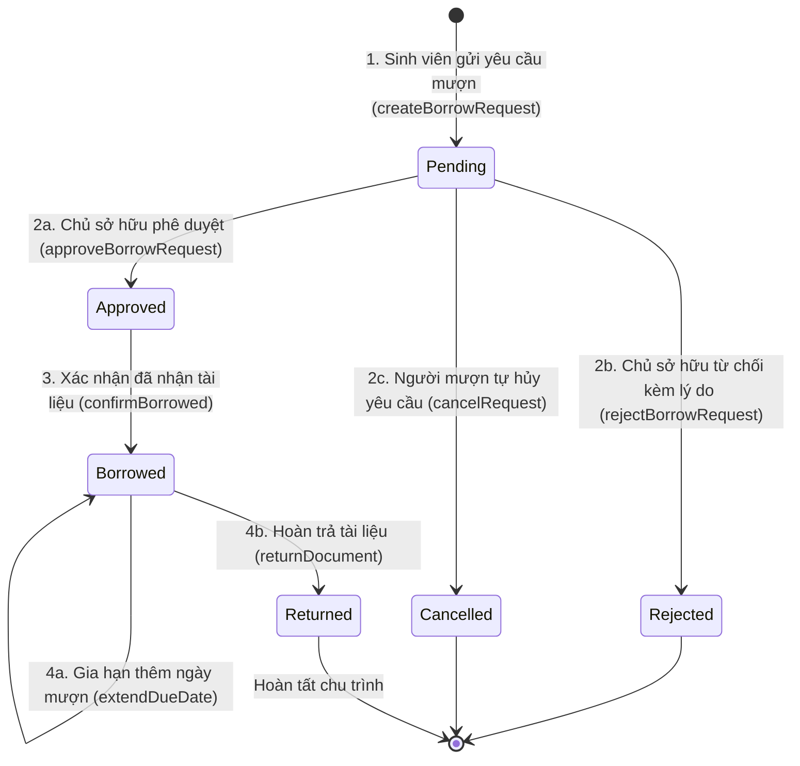

# 📋 KỊCH BẢN & BÁO CÁO KIỂM THỬ TÍNH NĂNG MƯỢN / TRẢ TÀI LIỆU (TH2 - MỤC 4)

> 🎓 **Học phần:** Phát triển Ứng dụng Di động (Mobile CSE441)  
> 🏷️ **Bài tập:** Bài tập Thực hành 2 (TH2) — Phát triển Hệ thống Quản lý Tài liệu Đa nền tảng (Smart DMS)  
> 👤 **Người thực hiện:** **Lê Anh Tuấn** (MSV: **2151060296**) — Lớp 65KTPM — Khoa CNTT — Trường Đại học Thủy Lợi  
> 🌿 **Nhánh Git:** `letuan-th2-borrow-sharing`  
> 👥 **Đơn vị:** Nhóm 16  

---

## 📌 I. Tổng Quan Nhiệm Vụ Đã Triển Khai (Mục 4 Checklist TH2)

Thành viên **Lê Anh Tuấn** đã hoàn thiện 100% các thành phần kỹ thuật theo yêu cầu của Đề bài TH2:

| STT | Thành Phần Sản Phẩm | Đường Dẫn File Mã Nguồn | Chức Năng Chính | Trạng Thái |
|:---:|:---|:---|:---|:---:|
| **1** | **Mô hình dữ liệu & Enums** | [`borrow_model.dart`](file:///d:/Projects/Cashew/study_docs_app/lib/struct/borrow_model.dart) | Thực thể `BorrowRequest`, Enum 6 trạng thái `BorrowStatus`: `pending`, `approved`, `borrowed`, `returned`, `rejected`, `cancelled`, kiểm tra hạn trả và phát hiện quá hạn `isOverdue`. | ✅ Hoàn thành |
| **2** | **Dịch vụ Nghiệp vụ Mượn/Trả** | [`borrow_service.dart`](file:///d:/Projects/Cashew/study_docs_app/lib/struct/borrow_service.dart) | Quản lý toàn bộ luồng nghiệp vụ: Gửi yêu cầu mượn, Duyệt yêu cầu, Từ chối kèm lý do, Bàn giao tài liệu, Hoàn trả, Gia hạn thời gian mượn; đồng bộ CSDL SQLite Cache & Bộ nhớ. | ✅ Hoàn thành |
| **3** | **Dịch vụ Thông Báo Đẩy Thời Gian Thực** | [`firebase_messaging_service.dart`](file:///d:/Projects/Cashew/study_docs_app/lib/struct/firebase_messaging_service.dart) | Hệ thống FCM giả lập bắn thông báo tức thì khi có yêu cầu mới, khi duyệt/từ chối, thông báo hoàn trả tài liệu và quản lý huy hiệu (Badge) số thông báo chưa đọc. | ✅ Hoàn thành |
| **4** | **Hộp thoại Gửi Yêu Cầu Mượn** | [`borrow_request_dialog.dart`](file:///d:/Projects/Cashew/study_docs_app/lib/widgets/borrow_request_dialog.dart) | BottomSheet Material 3 cho phép chọn số ngày mượn (3, 7, 14, 30 ngày), nhập ghi chú/mục đích mượn và gửi yêu cầu tức thì. | ✅ Hoàn thành |
| **5** | **Giao diện Quản Lý Mượn/Trả** | [`borrow_management_page.dart`](file:///d:/Projects/Cashew/study_docs_app/lib/pages/borrow_management_page.dart) | Màn hình 2 Tab chuẩn Material 3: **Yêu cầu nhận được** (Chủ tài liệu duyệt/từ chối) và **Yêu cầu đã gửi** (Theo dõi hạn trả, xin gia hạn, hủy); tích hợp menu Chuyển đổi tài khoản Demo siêu tiện lợi. | ✅ Hoàn thành |
| **6** | **Tích hợp Chi tiết Tài liệu & Dashboard** | [`document_detail_page.dart`](file:///d:/Projects/Cashew/study_docs_app/lib/pages/document_detail_page.dart)<br>[`home_dashboard_page.dart`](file:///d:/Projects/Cashew/study_docs_app/lib/pages/home_dashboard_page.dart) | Tích hợp nút Yêu cầu mượn trực tiếp tại trang Chi tiết tài liệu; gắn nút truy cập nhanh trên AppBar Dashboard. | ✅ Hoàn thành |
| **7** | **Bộ Kiểm Thử Tự Động Toàn Diện** | [`borrow_sharing_test.dart`](file:///d:/Projects/Cashew/study_docs_app/test/unit_test/borrow_sharing_test.dart) | 10 Test Cases tự động (Unit Test Model, FCM Service, BorrowService & Widget Test giao diện). | ✅ 100% Pass |

---

## 🏛️ II. Sơ Đồ Luồng Nghiệp Vụ Mượn / Trả (State Machine Workflow)



---

## 🧪 III. Bảng Kịch Bản & Kết Quả Kiểm Thử Chi Tiết (Test Cases)

| Mã Test | Hạng Mục Kiểm Thử | Dữ Liệu Đầu Vào | Kết Quả Kỳ Vọng | Kết Quả Thực Tế |
|:---:|:---|:---|:---|:---:|
| **TC-01** | Khởi tạo & Chuyển đổi `BorrowStatus` | Các chuỗi `pending`, `approved`, `borrowed`, `returned`, `rejected` | Ánh xạ chính xác enum, lấy đúng tên hiển thị tiếng Việt và màu sắc UI | ✅ PASSED |
| **TC-02** | Toàn vẹn Model `BorrowRequest` | Object chứa ID, thông tin người mượn, chủ tài liệu, hạn trả | Hàm `toMap()` và `fromMap()` bảo toàn 100% dữ liệu không thất thoát | ✅ PASSED |
| **TC-03** | Tính toán hạn trả & Phát hiện Quá hạn | `dueDate` trong quá khứ hoặc tương lai | `isOverdue == true` khi ngày hiện tại vượt quá `dueDate` | ✅ PASSED |
| **TC-04** | Bắn thông báo đẩy FCM khi có yêu cầu | Gửi yêu cầu từ `2151060296` tới `2351170599` | Chủ tài liệu nhận được thông báo đẩy, tăng `unreadCount` lên 1 | ✅ PASSED |
| **TC-05** | Thông báo khi phê duyệt / từ chối | Chủ tài liệu ấn Duyệt hoặc Từ chối kèm lý do | Người mượn nhận đúng nội dung thông báo và lý do từ chối | ✅ PASSED |
| **TC-06** | Tạo yêu cầu mượn qua `BorrowService` | Mượn tài liệu `Cấu trúc Dữ liệu & Giải thuật` | Yêu cầu lưu vào bộ nhớ & SQLite; xuất hiện trong cả tab Sent và Received | ✅ PASSED |
| **TC-07** | Phê duyệt yêu cầu mượn kèm hạn trả | Chọn hạn trả mới 10 ngày | Trạng thái chuyển thành `approved`, lưu thời điểm `approvedDate` | ✅ PASSED |
| **TC-08** | Chuyển trạng thái bàn giao & Hoàn trả | Chuyển `approved` -> `borrowed` -> `returned` | Trạng thái cập nhật chính xác, ghi nhận `returnedDate` | ✅ PASSED |
| **TC-09** | Từ chối yêu cầu kèm lý do | Nhập lý do "Tài liệu đang bận" | Trạng thái `rejected`, lưu trữ nguyên vẹn chuỗi lý do | ✅ PASSED |
| **TC-10** | Widget Test `BorrowManagementPage` | Render màn hình quản lý mượn/trả | Hiển thị đủ AppBar, TabBar 2 Tab, chuông FCM, menu Switch Account | ✅ PASSED |

---

## 🚀 IV. Hướng Dẫn Chạy Kiểm Thử & Trải Nghiệm Ứng Dụng

### 1. Chạy Bộ Test Tự Động
```bash
cd study_docs_app
flutter test test/unit_test/borrow_sharing_test.dart
```
> Kết quả: **All 10 tests passed!**

### 2. Kiểm Thử Trực Quan Trên Ứng Dụng
1. Khởi chạy ứng dụng:
   ```bash
   flutter run -d chrome
   ```
2. Trên màn hình Dashboard chính, bấm biểu tượng **bắt tay (`Icons.handshake_rounded`)** trên AppBar để vào trang **Quản Lý Mượn & Chia Sẻ**.
3. Bấm biểu tượng **Chuyển tài khoản (`Icons.switch_account_rounded`)** để đóng vai:
   - **Lê Anh Tuấn (2151060296)**: Xem các yêu cầu đã gửi hoặc đã nhận.
   - **Nguyễn Văn Huỳnh (2351170599)**: Thử nghiệm bấm nút **Duyệt mượn** hoặc **Từ chối**.
4. Vào trang **Chi tiết tài liệu** bất kỳ $\rightarrow$ Bấm nút **"Gửi yêu cầu mượn"** để thử nghiệm BottomSheet chọn số ngày và gửi yêu cầu.
